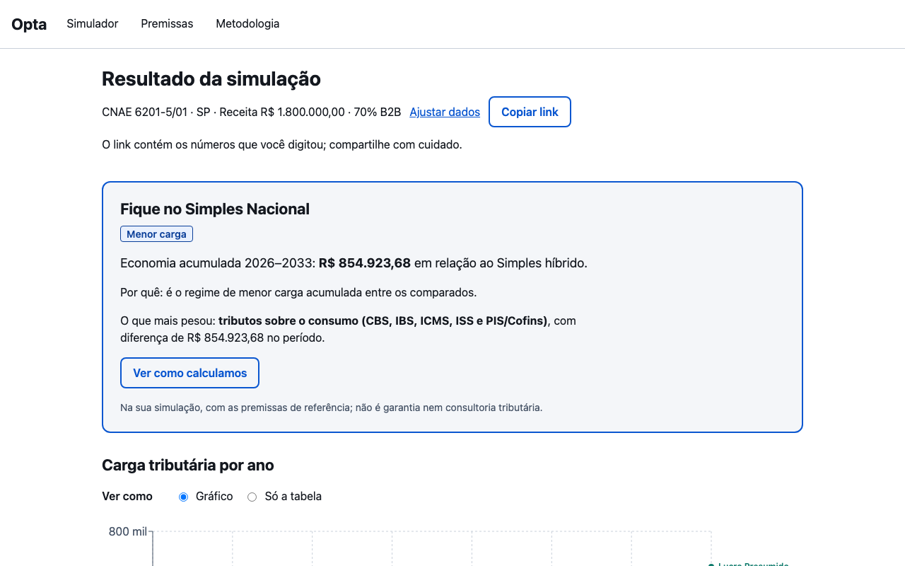
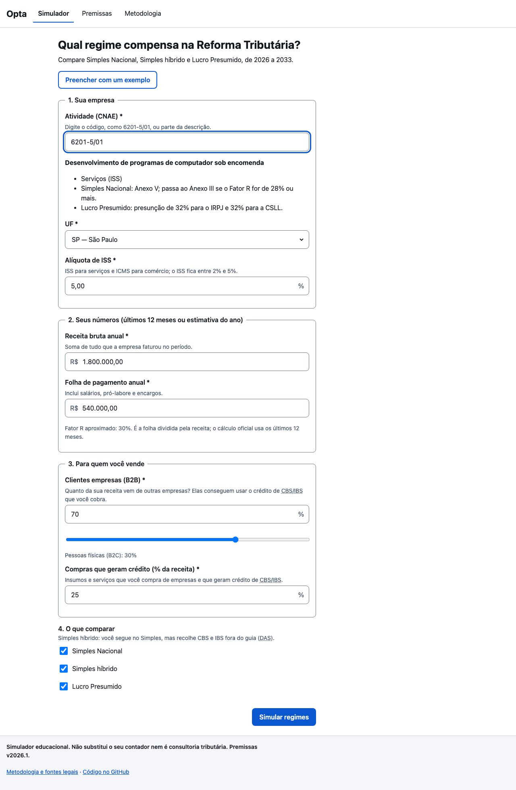
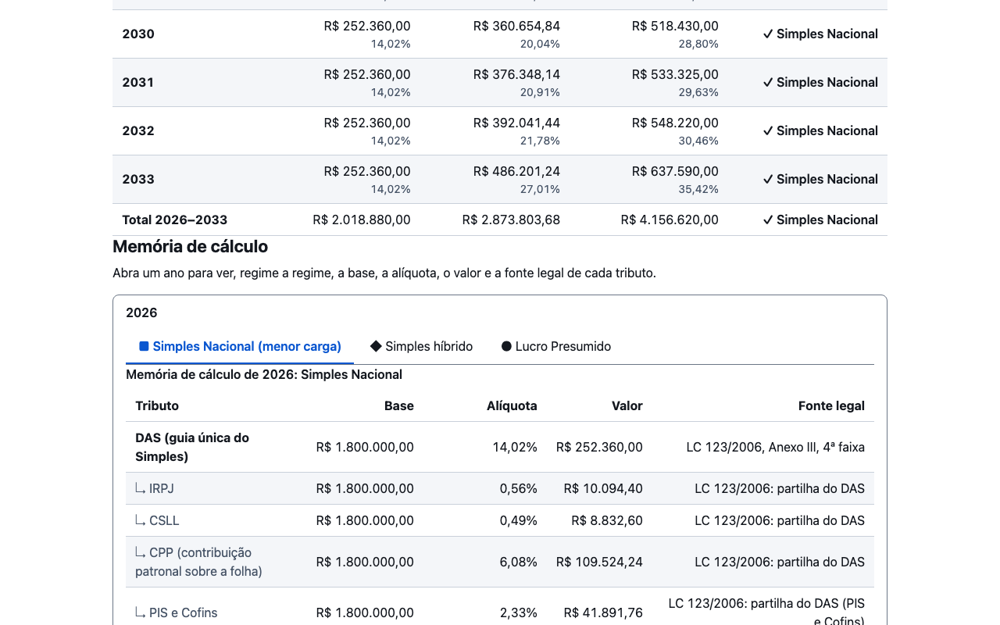
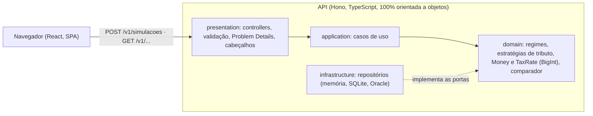

# Opta

**Qual regime tributário compensa na Reforma Tributária do Consumo?** O Opta compara **Simples Nacional**, **Simples híbrido** (CBS e IBS recolhidos por fora do DAS) e **Lucro Presumido**, ano a ano de **2026 a 2033**, recomenda o regime de menor carga e explica o que mais pesou. Cada número tem memória de cálculo com a fonte legal.

> Projeto educacional de portfólio: **não é consultoria tributária**. Regras e valores marcados com ⚠️ na documentação ainda precisam de conferência na fonte legal (issue [#60](https://github.com/PedroWC/opta/issues/60)).

<p>
  
</p>

<details>
<summary>More screenshots · Mais capturas de tela</summary>

| Simulador | Memória de cálculo | Celular |
|---|---|---|
|  |  |  |

</details>

## In English

Opta is a tax-regime simulator for Brazil's 2026–2033 consumption-tax reform (CBS/IBS). It compares three regimes year by year, recommends the cheapest one and shows an auditable calculation trail with the legal source of every line. It is a portfolio project built to demonstrate: a rich object-oriented domain (TypeScript, exact `BigInt` arithmetic, Strategy and Template Method), contract-first API design (OpenAPI 3.1 + Problem Details), property-based and mutation testing (90% mutation score), an accessible React front-end verified with real-browser E2E tests (axe, keyboard, 320 px reflow), and a strict security posture (same-origin delivery, CSP without `unsafe-eval`). The documentation is in Portuguese; identifiers are in English. **Educational only, not tax advice.**

## O que ele faz

- **Compara três regimes de 2026 a 2033**: Simples Nacional (Anexos III e V, com Fator R e partilha do DAS), Simples híbrido (CBS/IBS no regime regular, com crédito cheio ao cliente B2B) e Lucro Presumido (IRPJ com adicional, CSLL, CPP e os tributos sobre o consumo).
- **Recomenda e explica**: menor carga no ano e acumulada, economia sobre o segundo colocado e o fator que mais pesou (renda, folha ou consumo).
- **Mostra o caminho do cálculo**: base, alíquota, valor e fonte legal de cada tributo, ano a ano, regime a regime.
- **Reflete a transição**: CBS/IBS de teste em 2026, PIS/Cofins extintos em 2027, IBS crescente de 2029 a 2033 e ICMS/ISS decrescentes, com alíquotas de referência por **vigência** (mudar a lei é mudar dados, não código).
- **Link compartilhável sem servidor**: a simulação vai no fragmento da URL (`#v1.…`), que o navegador não envia a lugar nenhum.

Exemplo conferido à mão (serviços, R$ 300 mil de receita, 40% de compras com crédito): carga acumulada de 2026 a 2033 de **R$ 193.920,00** no Simples, **R$ 324.351,12** no Simples híbrido e **R$ 460.230,00** no Lucro Presumido. Esses valores são testes do repositório.

## Como rodar

Requisitos: Node 22.13 ou superior.

```bash
npm install
npm run web:install
npm run dev            # API em http://localhost:3000
npm run web:dev        # interface em http://localhost:5173 (proxy /v1 para a API)
```

Build estático servido pela própria API, pela mesma origem e com CSP restritiva ([ADR-0008](docs/arquitetura/adr/0008-front-servido-pela-api-sob-a-mesma-origem.md)):

```bash
npm run web:build
OPTA_WEB_DIR=web/dist npm start    # http://localhost:3000
```

Persistência das tabelas fiscais: `OPTA_DB=memory` (padrão), `sqlite` ou `oracle` ([persistência](docs/arquitetura/persistencia.md)). Exemplo: `OPTA_DB=sqlite npm start` cria `opta.db`, que o git ignora.

## Qualidade, com números

| Camada | Verificação | Resultado |
|---|---|---|
| Backend | `npm run check` (tipos, lint de OO e de camadas, testes com cobertura) | 242 testes, cobertura de linhas de 100% no núcleo |
| Núcleo | Testes de propriedades (fast-check) e de mutação (Stryker, `npm run mutation`) | 90,05% de mutantes mortos; limiar de 85% no [ADR-0007](docs/arquitetura/adr/0007-testes-de-propriedades-e-mutacao.md) |
| API | Respostas validadas contra o schema do [OpenAPI 3.1](docs/api/openapi.yaml) (Ajv) | Contrato escrito antes do código |
| Interface | `npm run web:check` (tipos, lint com `jsx-a11y`, testes, build) | 232 testes, `axe-core` em todas as telas |
| Ponta a ponta | Playwright contra a API real, desktop e celular (`npm run e2e --prefix web`) | 65 testes em desenvolvimento e 75 no build de produção |
| Acessibilidade e desempenho | Axe com cores reais, alvos de toque, foco, espaçamento de texto, zoom, 320 px; JS inicial, LCP e CLS | JS inicial abaixo de 200 KB gzip; [relatório da auditoria](docs/frontend/auditoria-final.md) |

CI no GitHub Actions: backend, interface, E2E em desenvolvimento e E2E no build de produção.

## Arquitetura



- Dependências apontam para dentro; `dependency-cruiser` e o ESLint garantem isso e a regra de "só classes" no backend ([ADR-0001](docs/arquitetura/adr/0001-backend-100-orientado-a-objetos.md)).
- Dinheiro em centavos (`bigint`) e alíquotas inteiras: nenhum `number` em conta ([ADR-0003](docs/arquitetura/adr/0003-precisao-numerica.md)).
- Parâmetros fiscais em tabelas com vigência, atrás de uma porta de repositório ([ADR-0004](docs/arquitetura/adr/0004-parametros-fiscais-com-vigencia.md)).
- Front-end em `web/`, separado, que só conhece o contrato da API; os tipos são gerados dele ([ADR-0006](docs/arquitetura/adr/0006-frontend-react-vite-spa.md)).

## Limites conhecidos

O que o simulador **não** faz nesta versão, e o que ainda depende de conferência ou de pessoas:

- Escopo: serviços e comércio; Simples só dos Anexos III e V (comércio mostra só o Lucro Presumido); sem substituição tributária, monofasia, Imposto Seletivo, indústria, MEI ou Lucro Real.
- Acima de R$ 3,6 milhões o ISS e o ICMS saem do DAS e não são calculados; a API e a Metodologia avisam.
- **Tabelas e premissas de referência ainda não conferidas na fonte legal** (partilha do DAS, alíquotas de CBS/IBS, presunções, mapa de CNAE): issue [#60](https://github.com/PedroWC/opta/issues/60).
- Adaptador Oracle testado só com conexão falsa: issue [#59](https://github.com/PedroWC/opta/issues/59).
- Leitor de tela real e teste com pessoas ainda não realizados (issue [#30](https://github.com/PedroWC/opta/issues/30)); não se deve afirmar que a interface foi testada com usuários.
- Demonstração pública (deploy) ainda não publicada (issue [#14](https://github.com/PedroWC/opta/issues/14)).

## Documentação

- **Para entender o projeto:** [artigo técnico](docs/artigo-tecnico.md) · [especificação](docs/especificacao.md) · [ADRs](docs/arquitetura/adr/README.md) · [registro de decisões](docs/processo/registro-de-decisoes.md) · [glossário](docs/arquitetura/glossario.md)
- **Requisitos:** [ERS](docs/requisitos/ers.md) · [regras de negócio](docs/requisitos/regras-de-negocio.md) · [rastreabilidade](docs/requisitos/rastreabilidade.md) · [casos de uso](docs/produto/casos-de-uso.md) · [histórias](docs/produto/historias-de-usuario.md) · [mapa do site](docs/produto/mapa-do-site.md)
- **API:** [contrato OpenAPI 3.1](docs/api/openapi.yaml) · [persistência](docs/arquitetura/persistencia.md)
- **Interface:** [plano](docs/frontend/plano-frontend.md) · [wireframes](docs/prototipos/wireframes-simulador.md) · [design system](docs/frontend/design-system.md) · [auditoria final](docs/frontend/auditoria-final.md)
- **Processo:** [backlog inicial](docs/processo/backlog-inicial.md) · [nomenclatura](docs/processo/nomenclatura.md) · [definição de pronto](docs/processo/definicao-de-pronto.md) · [CHANGELOG](CHANGELOG.md)

Cada mudança de comportamento atualiza a documentação e a matriz de rastreabilidade (RF/RN para teste) no mesmo PR; commits seguem Conventional Commits em PT-BR, e não há commit direto na `main`.
