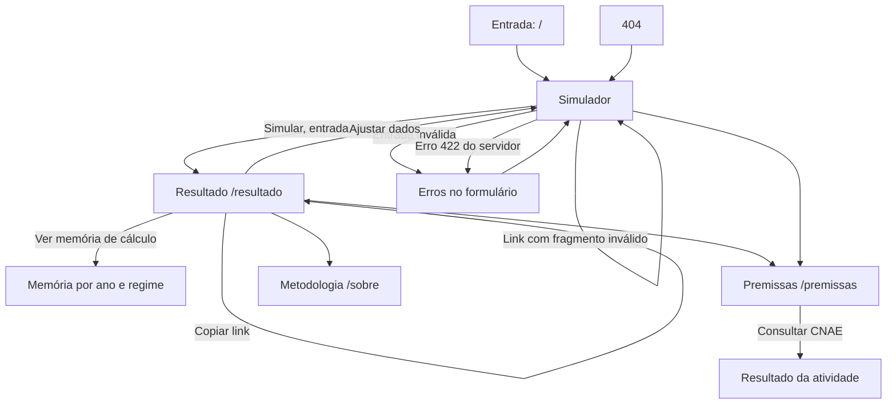

# Plano do front-end do Opta

> **Status:** aprovado em 2026-11-18, sem implementação ainda (decisões em [registro-de-decisoes.md](../processo/registro-de-decisoes.md)). Complementa a [especificação](../especificacao.md), seções 5 e 7, e o item #12 do [backlog](../processo/backlog-inicial.md). Documentos irmãos: [wireframes e fluxo de telas](../prototipos/wireframes-simulador.md), [design system](design-system.md), [acessibilidade e responsividade](acessibilidade-e-responsividade.md), [pesquisa com usuários](pesquisa-com-usuarios.md), [backlog do front](backlog-frontend.md) e [ADR-0006](../arquitetura/adr/0006-frontend-react-vite-spa.md).

## 1. Objetivo e princípios

Entregar a interface web do simulador (RF-08): formulário, tabela comparativa, gráfico por ano, recomendação explicada e memória de cálculo auditável, de 2026 a 2033.

1. **O front não calcula imposto.** Toda regra fiscal vive no backend (RN-01 a RN-10). O front valida o formato da entrada (RN-09), envia, formata e explica. Exceção única e opcional: uma dica de Fator R "aproximado" no formulário (ver seção 8, decisão D-4).
2. **O dinheiro nunca é calculado em `number` no front** (espírito de RNF-02). Valores chegam do contrato como texto decimal e só são convertidos para `number` na hora de desenhar o gráfico e formatar para exibição.
3. **Estado na URL, sem persistência no servidor.** A simulação é reproduzível por um link; nada fica guardado (RNF-06).
4. **Acessibilidade e responsividade são requisitos, não polimento** (RNF-09, RNF-10 propostos).
5. **Transparência fiscal:** aviso de que é simulador educacional, versão das premissas sempre visível e fonte legal em cada linha de cálculo.
6. **Versão pequena e completa primeiro:** fatias verticais que funcionam de ponta a ponta (ver backlog).

## 2. Personas e tarefas (hipóteses)

Detalhes e plano de teste em [pesquisa com usuários](pesquisa-com-usuarios.md). Resumo, marcado como **hipótese**:

| Persona | Contexto | Tarefa principal |
|---|---|---|
| Empresário(a) de serviços (Marina, 42) | Celular ou notebook, pouca familiaridade com CBS/IBS, decide pelo contador mas quer entender | "Quero saber em que regime ficar e por quê, em menos de 3 minutos." (US-01, US-02) |
| Contador(a) (Rogério, 51) | Desktop, domina o Simples, quer conferir | "Quero ver base, alíquota, valor e fonte legal de cada tributo para validar." (US-03, US-04) |
| Recrutador(a) ou dev avaliando o portfólio | 90 segundos de atenção | "Quero ver o produto funcionando e o cuidado técnico." (demo pública, #14) |

## 3. Escopo do front

**Dentro (MVP):** simulador, resultado (recomendação, tabela, gráfico, memória), premissas por ano, consulta de CNAE, página de metodologia e aviso legal, estados de erro, link compartilhável pelo fragmento da URL, tema claro (tokens já preparados para escuro).

**Fora do MVP (backlog pós-MVP):** tema escuro e alto contraste manual, inglês, exportação em CSV/PDF (a impressão do navegador cobre o básico), simulação interativa de sensibilidade ao percentual B2B, múltiplas atividades, login, histórico.

## 4. Fluxo de telas



Rotas:

| Rota | Tela | Casos de uso | Requisitos |
|---|---|---|---|
| `/` | Simulador | UC-01 (passos 1 e 2) | RF-01, RN-09 |
| `/resultado#...` | Resultado | UC-01 (passos 3 a 5) | RF-02, RF-03, RF-06, RF-08 |
| `/premissas` | Premissas e CNAE | UC-02, UC-03 | RF-04, RF-05 |
| `/sobre` | Metodologia, fontes e aviso legal | — | RF-11 (proposto) |
| `*` | Não encontrada | — | — |

Wireframes de cada tela (desktop e mobile, com estados): [wireframes-simulador.md](../prototipos/wireframes-simulador.md).

## 5. Stack

Decisão registrada em [ADR-0006](../arquitetura/adr/0006-frontend-react-vite-spa.md). Resumo:

| Necessidade | Escolha | Por quê (alternativa descartada) |
|---|---|---|
| Framework | **React 18+ com Vite (SPA)** | Já previsto no ADR-0002. Next.js não traz ganho aqui: não há SEO por página (as telas são ferramenta), nem SSR necessário, e exigiria um servidor Node a mais no deploy. |
| Linguagem | TypeScript `strict` | Preferência do projeto; tipos gerados do contrato. |
| Roteamento | React Router (modo SPA) | Três rotas; padrão de mercado. |
| Dados do servidor | TanStack Query | Cache, estados de carregamento e erro, cancelamento. |
| Formulário | React Hook Form + Zod | Validação por esquema espelhando RN-09; mensagens em PT-BR. O servidor continua sendo a autoridade (422). |
| Gráfico | Recharts com camada de acessibilidade ligada, mais tabela equivalente sempre disponível | Menor custo para 3 séries x 8 anos. visx dá mais controle, com mais código; fica como plano B se o teclado ou o leitor de tela não ficar aceitável. [A CONFIRMAR: versão e API de acessibilidade do Recharts na hora da implementação] |
| Estilo | CSS Modules + tokens em CSS custom properties | Sem dependência de runtime; tokens como fonte única (ver [design system](design-system.md)). Tailwind descartado para manter o vocabulário semântico dos tokens. |
| Primitivos de UI | Elementos nativos primeiro; Radix UI só onde o padrão ARIA é difícil (Combobox, Tabs, Dialog) | Menos código de acessibilidade para manter. |
| Testes | Vitest + Testing Library + `jest-axe`; MSW para simular a API; Playwright + `@axe-core/playwright` para E2E | Alinha com a spec (seção 8) e com as regras do repositório (Vitest). |
| Tipos da API | `openapi-typescript` a partir do contrato OpenAPI do #9 | Contrato escrito antes; o front quebra no build se o contrato mudar. |
| Qualidade | ESLint com `jsx-a11y`, `tsc --noEmit`, CI no mesmo workflow | RNF-09. |

Versões exatas ficam para a implementação (consultar a documentação vigente na hora, sem fixar números aqui).

### Onde mora no repositório

```
opta/
├─ src/ , test/            # backend (inalterado; regra OO do ADR-0001)
├─ web/                    # NOVO: pacote próprio do front
│  ├─ package.json
│  ├─ vite.config.ts       # proxy /v1 -> backend em dev
│  ├─ tsconfig.json
│  └─ src/ ...
└─ docs/
```

Pacote separado (`web/package.json`), sem workspaces no MVP, para não afetar o `npm run check` do backend. Pontos de atenção:

- O `eslint.config.js` do backend só cobre `src/**`; `web/` terá a própria configuração. A regra de OO do ADR-0001 **não se aplica** ao front (a spec, seção 4.1, já exclui o React), e isso será dito no ADR-0006.
- O CI ganha um job `web` (typecheck, lint, test, build) em paralelo ao do backend. Os scripts na raiz (`npm run web:dev`, `web:check`) só delegam.
- `.dependency-cruiser.cjs` do backend não olha `web/`; o front não importa nada de `src/` (o único elo é o contrato OpenAPI).

## 6. Estrutura de componentes

Organização por funcionalidade (feature folders), com uma biblioteca `ui/` sem conhecimento de domínio. Dependências só descem: `app` → `features` → `ui`/`lib`/`api`.

```
web/src/
├─ app/
│  ├─ main.tsx               # bootstrap
│  ├─ App.tsx                # providers (Query, Router)
│  └─ routes.tsx
├─ api/
│  ├─ opta-api-client.ts     # classe OptaApiClient (fetch, baseUrl, AbortSignal)
│  ├─ problem-details-error.ts   # classe ProblemDetailsError (RFC 9457 + code SIM-nnn)
│  ├─ schema.d.ts            # GERADO do OpenAPI
│  └─ hooks/                 # useSimulation, useAssumptions, useActivitySearch
├─ features/
│  ├─ simulator/
│  │  ├─ SimulatorPage.tsx
│  │  ├─ SimulationForm.tsx
│  │  ├─ fields/ (CnaeCombobox, MoneyField, ClientMixField, CreditablePurchasesField, RegimePicker)
│  │  ├─ simulation-input.schema.ts   # Zod: RN-09
│  │  ├─ example-input.ts             # US-01 (1,8 mi / 540 mil)
│  │  └─ input-url-codec.ts           # fragmento da URL <-> entrada
│  ├─ result/
│  │  ├─ ResultPage.tsx
│  │  ├─ RecommendationCard.tsx
│  │  ├─ YearlyChart.tsx
│  │  ├─ ComparisonTable.tsx
│  │  ├─ CalculationMemory.tsx   # acordeão por ano, abas por regime
│  │  ├─ AssumptionsBadge.tsx    # versão das premissas
│  │  └─ ResultSkeleton.tsx
│  ├─ assumptions/ (AssumptionsPage, TransitionTable)
│  └─ activity/ (ActivityLookup, ActivityCard)
├─ layout/ (AppShell, Header, Footer, SkipLink, LegalNotice, RouteAnnouncer)
├─ ui/                       # sem regra de negócio
│  └─ Button, TextField, Select, Slider, Checkbox, Combobox, Tabs, Disclosure,
│     Callout, Badge, Skeleton, Spinner, VisuallyHidden, Table, DefinitionList
├─ lib/ (format-money.ts, format-percent.ts, decimal-string.ts)
├─ styles/ (tokens.css, base.css, themes.css)
└─ test/ (msw handlers, fixtures tipadas, axe helper)
```

Decisões de design do código:

- **Classes onde há estado e dependência injetável**: `OptaApiClient` (recebe `baseUrl` e `fetch` por construtor, facilitando MSW e testes) e `ProblemDetailsError` (extends `Error`; carrega `status`, `code`, `detail`, `errors[]`). Componentes React ficam como funções (padrão da biblioteca), com a lógica extraída para hooks e módulos puros testáveis.
- **Componentes de página só orquestram**; apresentação em componentes pequenos; formatação em `lib/`.
- **Nenhum componente conhece regra fiscal.** Rótulos de regime vêm de um único mapa (`regime-labels.ts`): `SIMPLES` → "Simples Nacional", `SIMPLES_HIBRIDO` → "Simples híbrido", `LUCRO_PRESUMIDO` → "Lucro Presumido".
- Cada componente de `ui/` tem: variantes, matriz de estados (padrão, foco, desabilitado, erro, carregando), teste de teclado e teste `axe`.

## 7. Consumo da API

Contrato-base: especificação, seção 5, e `docs/produto/mapa-do-site.md`.

| Tela | Chamada | Quando | Cache |
|---|---|---|---|
| Resultado | `POST /v1/simulacoes` | Ao abrir `/resultado#...` (a entrada vem do fragmento) | `useQuery` com chave = entrada normalizada; `staleTime` infinito; tratado como consulta (não altera estado no servidor) |
| Premissas | `GET /v1/premissas/aliquotas?ano=` | Ao abrir; um ano por vez ou todos | `staleTime` longo (premissas mudam por versão) |
| Simulador, Premissas | `GET /v1/atividades?cnae=` e busca por texto | Ao digitar no combobox (debounce 250 ms), cancelando a anterior | por termo, 10 min |
| Rodapé | `GET /v1/versao` e `/v1/health` | Uma vez | sessão |

### Tratamento de erros (RNF-07)

`ProblemDetailsError` traduz a resposta `application/problem+json`. Mapa de comportamento:

| Situação | Tela | Comportamento |
|---|---|---|
| 422 / `SIM-001` com lista de campos | Simulador | Resumo de erros no topo (foco nele) + mensagem junto de cada campo |
| 422 sem campos | Simulador | Mensagem geral, mantém os dados |
| `SIM-002` (parâmetros sem vigência para algum ano) | Resultado | Aviso claro com o ano; mostra o que for possível, se o contrato permitir resultado parcial [A CONFIRMAR no #9] |
| 501 (`NotImplementedYet`, enquanto o backend está em construção) | Resultado | "Este regime ainda não está disponível nesta versão" e oculta a coluna |
| 5xx, rede ou tempo esgotado | Qualquer | Mensagem com "Tentar de novo"; nada de código técnico para o usuário; `code` fica visível em detalhe expansível para suporte |
| Fragmento da URL inválido | Simulador | Vai ao formulário preenchido no que for válido, com aviso |

**Privacidade (RNF-06):** o corpo da simulação trafega por `POST` (não aparece em URL de API), nada vai para analytics ou log do front, e os dados do link ficam no **fragmento** (`#`), que o navegador não envia ao servidor de hospedagem.

### Pedidos ao contrato (atendidos em [docs/api/openapi.yaml](../api/openapi.yaml), issue #9)

Os itens abaixo foram incorporados ao contrato (DEC-14). Diferenças: o fator decisivo usa os códigos `TRIBUTOS_SOBRE_RENDA`, `ENCARGOS_SOBRE_FOLHA`, `TRIBUTOS_SOBRE_CONSUMO` e `NENHUM` (categorias já calculadas no domínio; códigos mais finos, como crédito B2B, ficam como evolução); regimes que não se aplicam (por exemplo, receita acima do teto do Simples) vêm em `regimes_indisponiveis`, sem impedir os demais, o que resolve a dúvida sobre resultado parcial; e a busca de atividade usa `q`, `pagina` e `tamanho`. Propostas originais:

1. **Erros por campo** no Problem Details do 422: extensão `errors: [{ pointer: "/receita_bruta_anual", detail: "..." }]`. Hoje o handler devolve só `code` e `detail`.
2. **Valores monetários e alíquotas como texto decimal** (`"1800000.00"`, `"0.0600"`), não `number`, para não perder precisão no JSON (coerente com RNF-02 e ADR-0003).
3. **Busca de atividade por texto/prefixo**: `GET /v1/atividades?q=` (lista curta paginada), além de `?cnae=` exato, para o combobox.
4. **`GET /v1/premissas/aliquotas` sem `ano`** devolve a tabela de todos os anos (a tela de premissas faz uma chamada só).
5. **`premissas_versao` e `avisos[]`** na resposta da simulação (já previstos na spec) para o selo de versão e os alertas ⚠️ da legislação.
6. **CORS ou proxy:** em produção, servir o front e a API sob a mesma origem (ou configurar CORS restrito). Decidir no #14.
7. **Fator decisivo estruturado**: além do texto `recomendacao.motivo`, um campo `fator_decisivo` com código (`CREDITO_B2B`, `MARGEM`, `FOLHA`, `FAIXA_SIMPLES`) para o front mostrar um selo e permitir tradução.

Enquanto o #9 não existir, o front desenvolve contra **fixtures tipadas** e MSW; ao publicar o contrato, troca-se o tipo manual pelo gerado.

## 8. Decisões (resolvidas)

| # | Decisão | Recomendação |
|---|---|---|
| D-1 | SPA (Vite) ou Next? | **SPA. ADR-0006 aceito.** |
| D-2 | `web/` dentro do repositório do Opta ou repositório separado? | **Dentro, pacote próprio** (um clone, um CI, demo única). |
| D-3 | Recharts ou visx? | **Recharts com tabela equivalente**; trocar só se falhar no teste de leitor de tela. |
| D-4 | Mostrar "Fator R aproximado" ao vivo no formulário? | **Sim**, como dica informativa ("folha ÷ receita anual"), explicitamente "indicativo". Duplica uma divisão de RN-05, mas não decide nada. Se preferir pureza total, remover. |
| D-5 | Entrada percentual: usuário digita B2B e o B2C é calculado (soma 100%)? | **Sim:** um controle só, o complemento é automático (evita erro de soma). A API recebe os dois. |
| D-6 | Idioma da interface | **PT-BR no MVP;** textos em um único módulo para facilitar EN depois (README PT/EN está na fase 5). |

**Público e tom (decisão do mantenedor):** o foco é o empresário, com linguagem simples nas telas de formulário e resultado; a memória de cálculo e a página de metodologia ficam no nível técnico, para o contador.

## 9. Desempenho percebido

Metas (RNF-11 proposto): LCP ≤ 2,5 s em 4G simulado; JS inicial ≤ 200 KB gzip; CLS < 0,1; INP < 200 ms. Táticas: carregar o gráfico (`Recharts`) com `React.lazy` só na rota de resultado; fonte do sistema (sem webfont) no MVP; esqueleto na carga; `staleTime` alto; `preconnect` para a API se for outra origem. Medição com Lighthouse no CI (alerta, sem bloquear no início).

## 10. Segurança e privacidade do front

- Sem segredos no bundle; só a URL base da API como variável pública de build.
- Cabeçalhos no deploy: CSP restritiva (`default-src 'self'`; `connect-src` para a API), `Referrer-Policy: no-referrer`, `X-Content-Type-Options: nosniff`.
- Sem cookies, sem analytics, sem terceiros no MVP. Se houver métrica de uso no futuro, só agregada e sem dados da simulação.
- Todo texto vindo da API é renderizado como texto (React escapa por padrão); nada de `dangerouslySetInnerHTML`.
- `npm audit` no CI do front.

## 11. Estratégia de testes

| Nível | Ferramenta | O que cobre | Meta |
|---|---|---|---|
| Unitário | Vitest | `lib/` (formatação), `input-url-codec`, esquema Zod (RN-09), `ProblemDetailsError`, `OptaApiClient` | ≥ 80% (mesma régua das regras do repositório, mas só `lib/` e `api/` entram no limiar) |
| Componente | Testing Library + `jest-axe` | Cada `ui/` e cada tela com MSW, incluindo teclado e estados | Sem violação `axe` |
| Contrato | Tipos gerados + MSW com exemplos do OpenAPI | O front não aceita resposta fora do contrato | Falha no build |
| E2E | Playwright + `@axe-core/playwright` | US-01 (simular e ver tabela), US-02 (recomendação), link compartilhável, erro 422; 1–2 fluxos conforme spec §8 | Rodar no CI contra backend real em memória |
| Manual | Teclado, NVDA/VoiceOver, zoom 200%/400%, celular real | [Checklist de acessibilidade](acessibilidade-e-responsividade.md) | Antes do #14 |
| Usuários | 5 pessoas | [Plano](pesquisa-com-usuarios.md) | Antes do #14 |

Nomes de teste incluem o ID coberto (`RN-09: rejeita CNAE fora do formato`), como pedem as regras do repositório.

## 12. Documentos a atualizar quando o front for implementado

Conforme as regras do repositório, no mesmo PR de cada fatia: [ERS](../requisitos/ers.md) (RF-09 a RF-11, RNF-09 a RNF-12 propostos), [histórias](../produto/historias-de-usuario.md) (US-05 a US-10), [casos de uso](../produto/casos-de-uso.md), [mapa do site](../produto/mapa-do-site.md) (`/sobre` e fragmento), [protótipos](../prototipos/README.md), [rastreabilidade](../requisitos/rastreabilidade.md), README e CHANGELOG. Esta proposta **não altera** esses arquivos ainda; o texto pronto para entrar está em [backlog-frontend.md](backlog-frontend.md).
